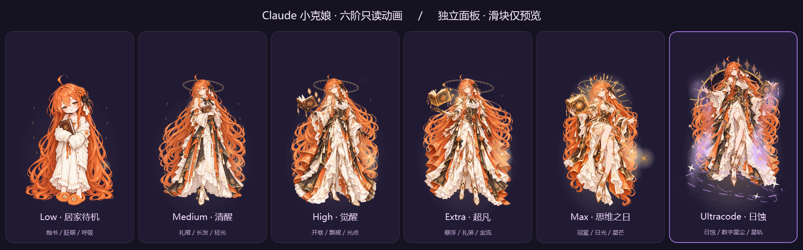

# Claude 小克娘 · 思考等级动态效果

独立的 Windows 桌面伴随程序，根据 Claude Desktop **Code 模式当前聊天的思考档位**，显示对应的小克娘形态与动画。当前版本：**1.1.0**。



| Claude 档位 | 小克娘形态 |
| --- | --- |
| Low | 居家抱书、眨眼与呼吸 |
| Medium | 清醒礼裙、长发与轻光 |
| High | 开卷觉醒、飘裙与光点 |
| Extra / xhigh | 华丽悬浮、礼装与金色能量流 |
| Max | 太阳冠冕、日光与星芒 |
| 原生 Ultracode | 日蚀、数字星尘与星轨 |

Ultracode 只有在聊天元数据 `sessionSettings.ultracode` 明确为 `true` 时才跟随。支持哪些实际档位由 Claude 原生客户端、模型和上游决定。

## 构建与启动

需要 Windows x64 和 .NET Framework 4.8。使用系统自带的 C# 编译器与 WPF，无需 Node.js、Python 或 API Key。

```powershell
git clone https://github.com/clowndest-svg/Claude-SiKaoDongTaiXiaoGuo.git
cd Claude-SiKaoDongTaiXiaoGuo
powershell.exe -NoProfile -ExecutionPolicy Bypass -File .\build.ps1
.\ClaudeXiaoKe.exe
```

构建后，也可以双击 `启动小克娘.cmd`。请保留程序旁的整个 `assets` 目录。Git 不收录生成的 EXE；GitHub Actions 成功运行后可下载包含 EXE、素材和使用脚本的构建产物。

不连接 Claude、只预览动画：

```powershell
.\ClaudeXiaoKe.exe --preview
```

默认读取 `%LOCALAPPDATA%\Claude-3p`。如需指定其他数据目录：

```powershell
.\ClaudeXiaoKe.exe --data="D:\ClaudeData"
```

## 使用

打开 Claude Desktop 的 Code 聊天，面板自动跟随侧栏选中的聊天；也可展开“跟随与聊天选择”，取消自动跟随后手动选择目标。

**面板滑块只预览六阶动画，不改变 Claude 的实际思考档位。** 调整实际档位请使用 Claude 原生 Effort 菜单。点击“结束预览”或切换聊天，可恢复自动跟随。

- 点击角色：轻跳、歪头与星芒回应。
- 拖动角色：移动位置。
- 右键：锁定位置、省电模式或退出。
- 普通模式最高 30 帧，省电模式最高 20 帧；Claude 隐藏时停止绘制。

## 自启与停止

请先将整个项目放在长期保留的目录，再运行：

```powershell
powershell.exe -NoProfile -ExecutionPolicy Bypass -File .\安装自启.ps1
```

脚本注册当前用户的 `ClaudeXiaoKeCompanion-ReadOnly` 登录计划任务，并启动小克娘。如果已有同名任务指向其他安装目录，脚本会拒绝覆盖。

运行 `停止小克娘.ps1` 只停止当前目录的程序，保留登录自启；运行 `卸载小克娘自启.ps1` 停止程序并移除该目录的自启任务，保留文件和设置。

## 只读行为与兼容性

程序从 Claude 的 `logs/main.log` 聚焦事件识别当前聊天，再只读对应会话元数据。只使用共享读取，不阻止文件轮转。不修改或注入 Claude 程序，不改原生菜单、模型、档位、网关、代理或 API 请求。组件自己的状态只写在本目录的 `runtime` 下。

适配基线为 Windows Microsoft Store Claude Desktop 4.29.0.0 的 Code 模式及 Claude-3p 数据目录。Chat、Cowork、其他分发版本、多窗口和多账户组合没有完整验证。内部日志与元数据不是稳定公开接口，未来客户端更新可能需要适配。识别不到聊天或遇到未知档位时会显示等待；新建未发送聊天不会借用其他聊天的档位。

角色素材由内置 ImageGen 根据用户提供的角色参考生成，保留透明通道；提示词在 `assets/prompts.json`，素材 SHA-256 在 `assets/SHA256SUMS.json`。

## 验证与目录

```powershell
powershell.exe -NoProfile -ExecutionPolicy Bypass -File .\scripts\test.ps1
```

验证会构建程序，核对六张素材哈希，执行 10 项聚焦/元数据只读检查，并用 WPF 检查六种形态在三个时刻的渲染与动态像素变化。测试仅使用合成聊天数据，结果输出到忽略提交的 `verification` 目录，不读取真实聊天；不等同于所有 Claude 版本的实际兼容性验证。

- `src/`：现有 v1.1.0 应用源码。
- `assets/`：六阶立绘、生成提示词与校验值。
- `tests/`、`scripts/test.ps1`：可重复运行的验证。
- `docs/images/`：形态展示图。

本仓库不收录本机 `runtime`、备份、聊天日志、旧版压缩包或历史验收中的本机状态。
